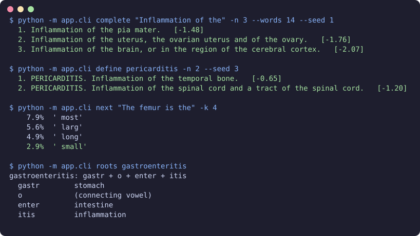

# Medical Terminology Helper

[](https://ask.thili.ai/b/4quatvyjas)
[](https://github.com/Sky00raider/medical-terminology-helper/actions/workflows/ci.yml)

A command-line assistant that completes medical phrases and dictionary definitions for students learning terminology. The GPT behind it is written from scratch in PyTorch (own byte-pair tokenizer, own causal self-attention, no pretrained weights) and trained on four public-domain medical books: Gray's *Anatomy* (1918), Gould's *Student's Medical Dictionary* (1900), Howell's *Physiology* (1921) and Lewis's *Anatomy and Physiology for Nurses* (1913).



<sub>Real output of the commands shown, rendered by `python scripts/render_demo.py`.</sub>

> **Headline (be aware of what this does and does not show).** The model writes fluent anatomical English: 99.6% of the words it generates are real words from the corpus, and "Inflammation of the" gets completed with organs ("urethra", "abdominal wall"). But the 0.94M-parameter model, trained for 13 minutes on a laptop CPU, does **not** yet beat a 4-gram baseline on held-out text (1.47 against 1.36 bits per character), and its definitions are generic frames ("A pain of the pancreas") rather than correct meanings (1.7% key-word overlap with the real definition). The numbers, the reasons and the next step (a bigger model on a free Colab T4, one command) are below.

## Quick start

You need Python 3.12.

```bash
python3.12 -m venv .venv && source .venv/bin/activate      # Windows: .venv\Scripts\activate
pip install -r requirements.txt
python -m app.cli complete "Inflammation of the"
```

The trained model (`models/model.pt`, 3.8 MB) and the cleaned corpus are committed, so nothing is downloaded and nothing needs training. Run the tests with `pytest` (48 tests, about 10 seconds, no network).

## Commands

| command | what it does |
|---|---|
| `complete "The femur is" -n 3 --words 20` | finish a partial phrase: 3 options, ranked by the model's confidence, about 20 words each |
| `define pericarditis` | dictionary-style definition (`PERICARDITIS. ...`) |
| `chat` | interactive: type a phrase, type `1`/`2`/`3` to keep an option and continue from it; `/define X`, `/roots X`, `/n`, `/words`, `/temp`, `/save`, `/saved` |
| `next "The femur is the" -k 5` | the most likely next tokens with probabilities (finishing the word you are typing) |
| `quiz -n 5` | flashcards: you define a held-out dictionary term, then see the real definition, the model's attempt and your key-word overlap |
| `roots gastroenteritis` | split a term into Greek/Latin parts (gastr + o + enter + itis) with meanings |
| `neighbours " heart"` | tokens the model embeds closest to a token |
| `saved` | completions you kept (`complete --pick` saves one) |

Sampling flags on `complete`, `define` and `chat`: `--words` (length), `-n` (options), `--temperature` (0 = greedy), `--top-k`, `--top-p`, `--seed`. `--model DIR` loads another checkpoint.

## What goes beyond the brief

The brief asks for BPE, a causal-attention GPT, training, generation and a CLI. Added on top:

- **Several ranked completions and a length control** (the stretch ideas), plus saving and loading the model (`save_model`/`load_model`, committed checkpoint).
- **Definition mode, an interactive chat, next-token candidates** and a **study quiz** that scores a student's own definition against held-out dictionary entries the model never saw.
- **A Greek/Latin root explainer** (`roots`), a **saved-completions history** (through the starter's `Store`) and **embedding neighbours**.
- **A baseline and honest measurement**: interpolated n-gram models (orders 1 to 4) over the same BPE tokens, scored in bits per character (tokenizer-independent), next-token accuracy and definition overlap (`scripts/evaluate.py`).
- **A tokenizer-aware prompt rule**: words carry their leading space inside tokens, so a prompt that ends in a space is encoded without it. Without this, `"Gastrocnemius muscle. "` produced garbage in a test that the model had memorised.
- A **GPU preset** (`--preset large`) for Colab; the CPU run is deliberately light.

## Milestones

| # | Milestone | Where |
|---|---|---|
| 1 | Curate a public-domain corpus, clean it | `scripts/download_data.py`, `scripts/build_corpus.py`, `clean_text`, `parse_dictionary` in `app/core.py`, `data/`, `results/corpus_stats.md` |
| 2 | Byte-pair tokenizer and embeddings | `BPETokenizer`, `Embeddings`, `nearest_tokens` |
| 3 | Causal self-attention and the transformer block | `CausalSelfAttention`, `Block`, `GPT` |
| 4 | Training loop on the medical text | `train`, `lr_at`, `scripts/train.py`, `models/`, `results/loss.csv` |
| 5 | Generation: sampling strategies and the loop | `filter_logits`, `generate_ids`, `complete`, `scripts/evaluate.py` |
| 6 | The CLI | `app/cli.py` |

All the model code is in [app/core.py](app/core.py), one section per milestone; tests are in [tests/test_core.py](tests/test_core.py), grouped the same way.

## Data and cleaning

| source | what it contributes |
|---|---|
| Gould, *The Student's Medical Dictionary* (1900) | 8,833 parsed `TERM. definition` entries (494 held out) |
| Gray, *Anatomy of the Human Body* (1918) | 9,054 paragraphs |
| Howell, *A Text-book of Physiology* (1921) | 4,575 paragraphs |
| Lewis, *Anatomy and Physiology for Nurses* (1913) | 1,475 paragraphs |

The texts are OCR scans from archive.org (`scripts/download_data.py`; all published before 1929). `clean_text` folds typography to ASCII, strips accents, rejoins words hyphenated across lines, drops figure references, headings, page furniture, number tables, all-capital running heads, OCR-garbled paragraphs and duplicates; long paragraphs are cut at sentence ends. `parse_dictionary` turns `Acetate (as-et-at) [acetum, vinegar]. Any salt of acetic acid.` into `ACETATE. Any salt of acetic acid.` and keeps only the leading sentences, so definitions are short and clean. Result: **6.78M training characters (1.10M words, 31,471 distinct)** and **0.43M validation characters**. The validation split is separate paragraphs plus 6% of dictionary entries chosen by a hash of the term; those held-out entries feed `quiz` and the definition test. The tokenizer is trained on the training split only.

## Architecture and training

```
text -> BPE tokens (vocab 1024) -> token embedding + position embedding           (B, T, 128)
     -> 4 x [ LayerNorm -> causal multi-head self-attention (4 heads) -> + residual
              LayerNorm -> feed-forward (4x, GELU)                    -> + residual ]
     -> LayerNorm -> output layer tied to the token embedding -> next-token distribution
```

0.94M parameters, context 128 tokens. AdamW (lr 3e-3, weight decay 0.1 on matrices only), linear warm-up then cosine decay, gradient clipping at 1.0, batch 32, 1,800 steps (7.4M tokens, about 3 passes over the corpus), 795 seconds on 8 CPU threads at below-normal priority. Validation loss fell from 6.94 (uniform guessing is ln 1024 = 6.93) to 2.96, with training loss 2.95, so the model is still **underfitting**: it is limited by size and time, not by memorising.

## Results

Full tables, side-by-side definitions and the training curve are in [results/results.md](results/results.md), produced by `python scripts/evaluate.py`.

**Predicting held-out text** (146,944 predictions on text the model never saw; every model uses the same BPE tokens):

| model | bits per character | next-token top-1 | top-5 |
|---|---|---|---|
| GPT (this project) | 1.472 | 36.9% | 60.0% |
| unigram | 2.925 | 7.5% | 17.8% |
| 2-gram | 1.842 | 23.0% | 47.6% |
| 3-gram | 1.412 | 39.5% | 65.2% |
| 4-gram | **1.363** | **44.4%** | **67.2%** |

(The n-gram accuracies use a subsample of 800 positions; the GPT uses all of them.)

**Defining 80 held-out dictionary terms** (prompt `TERM. `, scored against Gould's real definition):

| method | key-word overlap | real-word rate | mean words |
|---|---|---|---|
| GPT greedy | 1.7% | 99.6% | 5.4 |
| GPT sampled (T=0.7) | 1.2% | 93.2% | 7.2 |
| 4-gram greedy | 3.6% | 99.8% | 13.5 |

Real outputs (`temperature 0.7, seed 0`):

```
Inflammation of the           -> splanchnic cavity.
The function of the kidney    -> is in the pelvic cavity.
Blood is carried from the heart by -> the brain.
PERICARDITIS.                 -> Pertaining to or characterized by the mesentery.
ANEURYSM.                     -> Situated in which the bottom of a little mye.
```

```
$ python -m app.cli define pericarditis -n 2 --seed 3
  1. PERICARDITIS. The formation of multipital.   [-1.75]
  2. PERICARDITIS. The example of the functions of the genital organ.   [-1.87]
```

## Findings

1. **It learned the register, not the facts.** Completions are grammatical, use the right vocabulary (organs, cavities, vessels; 99.6% real words) and follow the dictionary format, but the content is mostly wrong ("Blood is carried from the heart by the brain"). The model knows what a definition looks like, not what pericarditis is.
2. **At this size the GPT loses to a 4-gram** on the same tokens (1.47 against 1.36 bits per character, 36.9% against 44.4% top-1). It beats the 2-gram and unigram by a wide margin but also loses narrowly to the 3-gram (1.41). With 0.94M parameters and 13 CPU-minutes it is under-trained (train and validation loss are equal), so the likely fix is more capacity and more steps, which is what the Colab preset is for. I have not run it yet, so I make no claim about the result.
3. **Definitions: both models are poor** (1.7% and 3.6% key-word overlap). The 4-gram scores higher mostly because it writes longer, wordier definitions that hit more common words (13.5 words against 5.4); neither is a usable definition.
4. **The embeddings picked up real structure.** Nearest neighbours of ` artery` are ` arteries`, ` vein`, ` veins`, ` vessels`; of ` heart` are ` brain`, ` blood`, ` system`, ` pressure`.
5. **BPE splits rare terms into many pieces** (about 2.9 characters per token): `hemoglobin` is `hem · og · lo · bin` but `gastrocnemius` is 7 tokens and `thrombocytopenia` 9. A 1,024-token vocabulary is too small to keep medical roots whole, which hurts exactly the terms a student cares about.

## Limitations

- **Do not use it for medical facts.** It generates plausible text, not verified knowledge, and its sources are 100 years old: terminology, doses ("Dose gr. ij-x") and treatments are outdated.
- Single training run, single seed; no confidence intervals. The key-word overlap metric is crude (it ignores synonyms and word order) and the n-gram accuracies use a subsample.
- The corpus is OCR text; some noise survives cleaning (garbled words in dictionary entries, "I." for "1.").
- Rare terms are fragmented by the small BPE vocabulary (finding 5); the context is 128 tokens.
- The `.env`/`app/llm.py` chat settings from the starter are not used: everything runs locally.

## Reproduce everything

```bash
python scripts/download_data.py     # 4 books from archive.org into data/raw/ (about 12 MB)
python scripts/build_corpus.py      # clean -> data/train.txt, data/val.txt, data/glossary.json, results/corpus_stats.md
python scripts/train.py             # small preset, about 13 minutes on 8 CPU threads -> models/, results/loss.csv
python scripts/evaluate.py          # -> results/results.md (about 2 minutes)
python scripts/render_demo.py       # -> docs/demo.svg from the real CLI
pytest
```

**Bigger model on a free Colab T4** (about 11M parameters, 2,500 steps; I have not run it yet): open [notebooks/colab_train.ipynb](https://colab.research.google.com/github/Sky00raider/medical-terminology-helper/blob/main/notebooks/colab_train.ipynb) in Colab, pick a T4 runtime and Run all. It trains `--preset large --device cuda`, runs `scripts/evaluate.py` and downloads `result.zip` with `models/` and `results/`, which then get committed. The best-validation checkpoint is kept, so overfitting cannot make the saved model worse.

## Settings and secrets

Model settings from the starter live in `.env`, which git ignores; this project does not need one. Never commit `.env` or a key.
